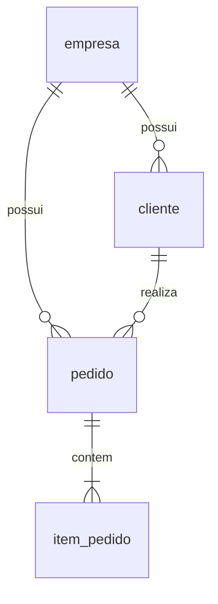

# Estrutura, modelo e contrato da API

Java 21, Spring Boot, Spring Data JPA e Flyway. Repositórios `JpaRepository` usam JPQL para as consultas por empresa. A aplicação compartilha banco e schema entre empresas, com `tenant_id` nas tabelas de negócio.

## Estrutura do código

Os pacotes ficam em `app/src/main/java/br/edu/tcc/pedidos/`. Somente `PedidosApplication` permanece na raiz; cada classe, record e enum tem seu próprio arquivo.

| Pacote | Responsabilidade |
| --- | --- |
| `controller` | Rotas de empresa, cliente e pedido; recebe e valida DTOs HTTP |
| `dto.request` / `dto.response` | Contratos de entrada e saída da API |
| `service` | Casos de uso, transações, validações de negócio e cálculo do total dos pedidos |
| `model` | Entidades JPA, status e resumo dos pedidos, sem dependência da camada web |
| `mapper` | Conversão explícita entre DTOs e modelos, usada somente pelos controllers |
| `repository` | Interfaces `JpaRepository` por entidade e consultas JPQL, sem DTOs HTTP |
| `cache` / `config` | Cache-aside, métricas e configuração Spring |
| `event` / `exception` | Invalidação após commit e tratamento de erros |

Os controllers recebem e retornam DTOs e fazem os mapeamentos. Os serviços recebem modelos ou valores simples, delimitam as transações e retornam entidades ou `Page<PedidoResumo>`. Os repositórios consultam e persistem entidades; o cálculo do total permanece no serviço. `ConsultaPedidosService` coordena a leitura com cache opcional, enquanto `PedidoService` mantém a consulta transacional ao PostgreSQL. Hibernate valida o schema criado pelo Flyway; `open-in-view` fica desligado.

## Modelo



| Entidade | Dados principais |
| --- | --- |
| empresa | ID, nome e criação |
| cliente | ID, empresa, nome e criação |
| pedido | ID, empresa, cliente, status, total, criação e atualização |
| item_pedido | ID, empresa, pedido, descrição, quantidade e preço unitário |

`tenant_id` referencia `empresa.id`; os IDs são globais. Chaves estrangeiras compostas impedem vínculos entre empresas. A API cria pedidos transacionalmente com 1–100 itens e calcula o total usando `BigDecimal` e `numeric`. O banco não garante sozinho a quantidade mínima de itens. Itens não são editáveis; o status pode mudar entre `ABERTO`, `CONFIRMADO` e `CANCELADO`, sem regras de transição.

## Listagem avaliada

```http
GET /api/pedidos?page=0&size=20
tenantId: 1
```

A resposta contém `content` com resumos (`id`, `clienteId`, `clienteNome`, `status`, `total`, `criadoEm`), além de `page`, `size`, `totalElements`, `totalPages`, `first` e `last`.

| Parâmetro | Regra |
| --- | --- |
| `tenantId` | ID positivo da empresa |
| `page` | Base zero; padrão 0; máximo 1.000.000 |
| `size` | De 1 a 100; padrão 20 |
| `sort` | Campos `id`, `criadoEm`, `status` ou `total`, com direção `asc`/`desc` |
| Ordem padrão | `criadoEm DESC, id DESC` |

A entrada usa `Pageable`, com os limites acima. Para ordenar por mais de um campo, repita `sort`, por exemplo `?page=0&size=20&sort=status,asc&sort=criadoEm,desc`. O ID é acrescentado como desempate quando não foi informado; campos ou direções inválidos retornam 400.

A consulta JPQL une pedido e cliente, filtra pela empresa e retorna resumos sem carregar itens. A validação da empresa, a página e sua contagem usam uma transação de leitura `REPEATABLE READ`; conteúdo e total compartilham o mesmo snapshot. Em páginas parciais, o Spring Data pode inferir o total e dispensar a consulta de contagem. Requisições para páginas diferentes podem observar mudanças concorrentes. O índice `(tenant_id, criado_em DESC, id DESC)` atende à ordem padrão; outras ordens e páginas com deslocamentos maiores podem aumentar o custo.

Empresa inexistente retorna 404. Empresa sem pedidos ou página além do fim retorna conteúdo vazio, preservando o total real. Cabeçalho ausente/inválido e paginação inválida retornam 400.

`tenantId` seleciona a empresa no laboratório e pode ser alterado pelo cliente. Autenticação, autorização de usuários e RLS não estão implementados. Os testes verificam o isolamento conforme o contexto informado; use a API apenas na rede experimental confiável.

## Operações auxiliares

| Método | Rota | Entrada e resultado |
| --- | --- | --- |
| POST | `/api/empresas` | `{"nome":"Empresa A"}` → 201 com ID |
| POST | `/api/clientes` | Nome + tenant → 201 com ID |
| POST | `/api/pedidos` | Cliente e itens + tenant → 201 com resumo |
| PATCH | `/api/pedidos/{id}/status` | `{"status":"CONFIRMADO"}` + tenant → resumo atualizado |
| GET | Porta administrativa local, `/actuator/health` | Saúde da API e PostgreSQL, sem detalhes de credenciais |
| GET | Porta administrativa local, `/actuator/metrics` | Contadores para o coletor na VM da aplicação |

Veja [exemplos HTTP](../app/README.md). Não há exclusão, frontend ou pagamentos. O [cache opcional](CACHE.md) preserva o mesmo contrato.

## Dados reproduzíveis

Na raiz do repositório:

```sh
python3 scripts/gerar_base.py --empresas 10 --clientes-por-empresa 20 \
  --pedidos-por-empresa 10000 --itens-por-pedido 3 --lote exp-001 --saida /tmp/tcc-exp-001.sql
```

O exemplo gera um arquivo SQL novo, sem conexão com o banco: 100.000 pedidos e 300.000 itens, clientes distribuídos ciclicamente e datas determinísticas. Cada item possui quantidade 1 e preço de R$ 10,00; o total do pedido corresponde à soma dos itens. A base definitiva contém 100 empresas, cada uma com 5.000 clientes e 20.000 pedidos de três itens: 8.500.100 registros. Não há entidade produto. Essa distribuição controlada não representa todos os padrões de um SaaS.

Após revisão e confirmação, aplique o arquivo como `tcc_migrator`, proprietário das tabelas, com `psql -X -v ON_ERROR_STOP=1 -f ARQUIVO`. O SQL inclui `ANALYZE` e retorna os IDs das empresas; não presuma IDs iniciando em 1. A carga valida contagens por empresa, quantidade de itens e totais de cada pedido antes do commit. Lotes existentes são recusados sem apagar dados; execuções do mesmo lote são serializadas no banco, evitando a duplicação concorrente desse lote. Aumente o volume gradualmente conforme o espaço disponível.

## Próximas etapas

1. Implantar e validar a API, os usuários e as migrações em uma base experimental isolada.
2. Carregar e conferir a base, revisar planos SQL e preparar backup/restauração.
3. Configurar a VM de carga no segundo computador e validar os coletores.
4. Executar o piloto e depois a campanha conforme [EXPERIMENTO.md](EXPERIMENTO.md).

O protocolo fixa paginação, 25 empresas ativas, localidade, escritas efetivas, TTL, pareamento e coleta. Os arquivos preparados não representam validação remota desses procedimentos.
