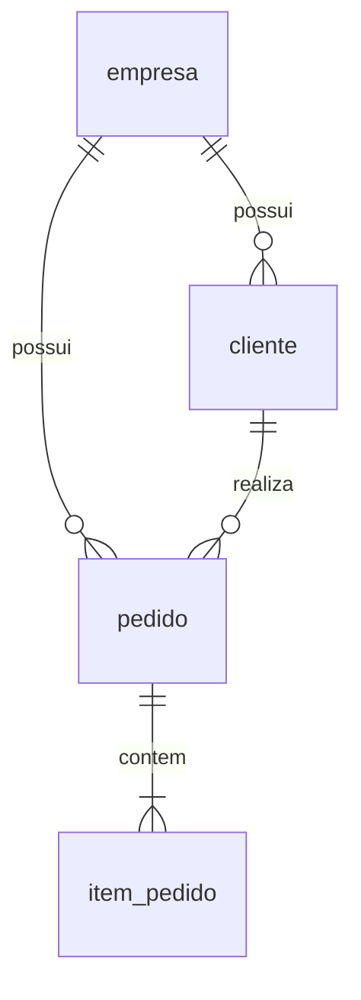

# Aplicação e experimento: pedidos paginados por empresa

## Decisões aprovadas

Entidades: empresa, cliente, pedido e item_pedido. A operação principal é **listar os pedidos de uma empresa com paginação**. A consulta de detalhes não é a operação de referência.

A primeira implementação usa Java 21, Spring Boot 3.5.16, JDBC, PostgreSQL e Flyway. SQL explícito torna visíveis a consulta paginada e a contagem que serão medidas. Os records Java representam os contratos e resultados; o modelo relacional é definido pelas migrações. Redis permanece sem uso pela aplicação nesta etapa.

## Modelo



- `empresa`: identificador, nome e data de criação.
- `cliente`: identificador, `tenant_id`, nome e data de criação.
- `pedido`: identificador, `tenant_id`, cliente, status, total, criação e atualização.
- `item_pedido`: identificador, `tenant_id`, pedido, descrição, quantidade e preço unitário.

`tenant_id` referencia `empresa.id`. FKs compostas impedem que um pedido use um cliente de outra empresa ou que um item pertença a um pedido de outra empresa. Os identificadores são globais. Valores monetários usam `numeric` e `BigDecimal`; o total é calculado pela aplicação, sem aceitar total informado pelo cliente. Um pedido criado pela API possui de 1 a 100 itens; o banco não impõe a cardinalidade mínima de itens sozinho. A criação é transacional. Nesta etapa os itens não são editáveis; somente o status do pedido pode mudar, sem fluxo de transição obrigatório.

## Contrato principal

```http
GET /api/pedidos?page=0&size=20
X-Tenant-Id: 1
```

```json
{
  "content": [
    {
      "id": 123,
      "clienteId": 10,
      "clienteNome": "Cliente A",
      "status": "ABERTO",
      "total": 24.70,
      "criadoEm": "2026-01-01T10:00:00Z"
    }
  ],
  "page": 0,
  "size": 20,
  "totalElements": 1,
  "totalPages": 1,
  "first": true,
  "last": true
}
```

- Página começa em zero. Padrão: 20 registros. Tamanho permitido: 1–100. Página permitida: 0–1.000.000.
- Ordem fixa: `criado_em DESC, id DESC`. O ID desempata pedidos criados no mesmo instante.
- Lista contém resumos, sem carregar todos os itens de cada pedido. Cliente e pedido são unidos por empresa e identificador na mesma consulta.
- Consulta da página usa `LIMIT/OFFSET`; contagem exata usa `COUNT(*)` filtrado pela mesma empresa. Há também uma consulta curta para validar a existência da empresa.
- As três leituras usam uma transação de leitura `REPEATABLE READ`: conteúdo e contagem pertencem ao mesmo snapshot. Páginas pedidas em requisições diferentes podem mudar sob inserções concorrentes.
- Empresa inexistente retorna 404. Empresa sem pedidos retorna lista vazia e total zero. Página além do fim retorna lista vazia e mantém o total real.
- Empresa ausente/inválida, página inválida ou tamanho fora do intervalo retornam 400.
- O índice `(tenant_id, criado_em DESC, id DESC)` atende ao filtro e à ordem. OFFSET e contagem exata podem aumentar o custo conforme a base cresce; isso faz parte da operação estudada.

`X-Tenant-Id` seleciona a empresa no laboratório. Não autentica o usuário: quem controla o cabeçalho pode selecionar outra empresa. Os testes comprovam que consultas e vínculos respeitam o contexto informado; autorização de usuários e RLS não estão implementados. Restrinja a API à rede experimental confiável. Criação de empresas também é uma operação de preparação do laboratório.

## Operações auxiliares

| Método | Rota | Corpo e resultado |
| --- | --- | --- |
| POST | `/api/empresas` | `{"nome":"Empresa A"}` → 201 com identificador |
| POST | `/api/clientes` | `{"nome":"Cliente A"}` + tenant → 201 |
| POST | `/api/pedidos` | Cliente e itens + tenant → 201 com resumo |
| PATCH | `/api/pedidos/{id}/status` | `{"status":"CONFIRMADO"}` + tenant → resumo atualizado |
| GET | `/actuator/health` | Saúde HTTP e conexão com o banco; sem detalhes de credenciais |

Status: `ABERTO`, `CONFIRMADO`, `CANCELADO`. Não há exclusão, frontend ou integração de pagamento.

## Caminho de implementação

1. **Concluído localmente:** schema, migração inicial, API sem cache, isolamento por contexto, paginação, configuração Docker e testes de integração PostgreSQL.
2. **Preparado para execução autorizada nas VMs:** criar roles, aplicar migrações, implantar API e gerar dados experimentais. Esses passos modificam o ambiente e não foram executados neste incremento.
3. **Próxima implementação:** cache-aside da resposta paginada inteira. A chave deverá incluir empresa, página, tamanho e versão do contrato. Alterar/criar pedido invalida todas as páginas e suas contagens daquela empresa, não apenas uma chave por pedido. Definir TTL, estratégia de invalidação após commit e testes de corridas antes de ativar Redis.
4. **Referência experimental:** revisar planos com dados representativos, controlar estatísticas do banco e medir modo sem cache. Depois comparar o mesmo endpoint com cache frio/aquecido e mesmos parâmetros.
5. **Carga externa:** configurar segundo computador/k6, executar repetições e registrar p50/p95/p99, throughput, erros e recursos. Variar também a distribuição de empresas e páginas acessadas, pois ela afeta a taxa de acertos do cache.

## Dados reproduzíveis

O gerador apenas escreve um arquivo SQL novo; não conecta ao PostgreSQL:

```sh
python3 scripts/gerar_base.py --empresas 10 --clientes-por-empresa 20 \
  --pedidos-por-empresa 10000 --lote exp-001 --saida /tmp/tcc-exp-001.sql
```

Isso representa 100.000 pedidos, cada um com um item de R$ 10,00. Clientes são distribuídos de forma cíclica; datas são determinísticas e a distribuição é uniforme. Esse conjunto inicial não representa todas as cargas reais de um SaaS. Registre o lote e os IDs retornados; não presuma que empresas começam em 1. A transação recusa um lote já existente, sem apagar dados. Não execute duas cargas simultâneas: o bloqueio por nome é uma proteção operacional, não uma chave única de idempotência concorrente.

Aplicação do SQL deve ocorrer separadamente e com confirmação, como `tcc_migrator`, via `psql -X -v ON_ERROR_STOP=1 -f ARQUIVO`. Esse usuário é proprietário das tabelas e pode executar ANALYZE. Aumente os volumes gradualmente e confira espaço em disco; gerar o arquivo não avalia a capacidade das VMs.

## Fontes técnicas

- [Spring Boot e acesso SQL](https://docs.spring.io/spring-boot/3.5/reference/data/sql.html).
- [Documentação PostgreSQL: índices multicoluna](https://www.postgresql.org/docs/17/indexes-multicolumn.html).
- [Documentação PostgreSQL: isolamento de transações](https://www.postgresql.org/docs/17/transaction-iso.html).

## Validação realizada neste incremento

Em 15/10/2026, `mvn verify` concluiu com sucesso: **10 testes de integração, zero falhas e zero testes ignorados**, com PostgreSQL 17.11 descartável. Foram verificados isolamento das páginas e contagens, desempate de horários por ID, vínculos entre empresas, atualização de status, limites e entradas inválidas, páginas vazias, precisão dos itens, restrições DDL do usuário runtime e execução/rejeição de repetição do gerador. O pacote executável foi gerado e o Compose da aplicação passou por `config --quiet`.

O build da imagem Docker, a aplicação das roles/migrações nas VMs e a implantação da API permanecem pendentes. Nenhuma VM foi acessada ou alterada neste incremento. O ensaio não é uma medição de desempenho.
