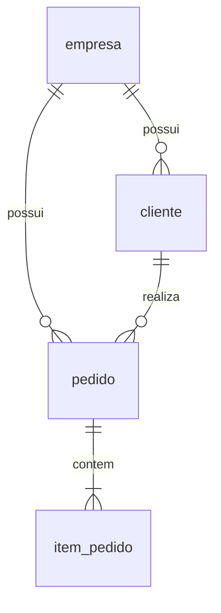

# Modelo e contrato da API

Java 21, Spring Boot, JDBC e Flyway. SQL explícito permite avaliar a consulta paginada e sua contagem. A aplicação compartilha banco e schema entre empresas, com `tenant_id` nas tabelas de negócio.

## Modelo



| Entidade | Dados principais |
| --- | --- |
| empresa | ID, nome e criação |
| cliente | ID, empresa, nome e criação |
| pedido | ID, empresa, cliente, status, total, criação e atualização |
| item_pedido | ID, empresa, pedido, descrição, quantidade e preço unitário |

`tenant_id` referencia `empresa.id`; os IDs são globais. Chaves estrangeiras compostas impedem vínculos entre empresas. A API cria pedidos transacionalmente com 1–100 itens e calcula o total usando `BigDecimal` e `numeric`. O banco não garante sozinho a quantidade mínima de itens. Itens não são editáveis; o status pode mudar entre `ABERTO`, `CONFIRMADO` e `CANCELADO`, sem regras de transição.

## Listagem avaliada

```http
GET /api/pedidos?page=0&size=20
X-Tenant-Id: 1
```

A resposta contém `content` com resumos (`id`, `clienteId`, `clienteNome`, `status`, `total`, `criadoEm`), além de `page`, `size`, `totalElements`, `totalPages`, `first` e `last`.

| Parâmetro | Regra |
| --- | --- |
| `X-Tenant-Id` | ID positivo da empresa |
| `page` | Base zero; padrão 0; máximo 1.000.000 |
| `size` | De 1 a 100; padrão 20 |
| Ordenação | `criado_em DESC, id DESC` |

A consulta usa `LIMIT/OFFSET`, une cliente e pedido por empresa e ID, e não carrega itens. A validação da empresa, a página e o `COUNT(*)` usam uma transação de leitura `REPEATABLE READ`; conteúdo e total compartilham o mesmo snapshot. Requisições para páginas diferentes podem observar mudanças concorrentes. O índice `(tenant_id, criado_em DESC, id DESC)` atende ao filtro e à ordem; OFFSET e contagem exata podem ficar mais caros com o crescimento da base.

Empresa inexistente retorna 404. Empresa sem pedidos ou página além do fim retorna conteúdo vazio, preservando o total real. Cabeçalho ausente/inválido e paginação inválida retornam 400.

`X-Tenant-Id` seleciona a empresa no laboratório e pode ser alterado pelo cliente. Autenticação, autorização de usuários e RLS não estão implementados. Os testes verificam o isolamento conforme o contexto informado; use a API apenas na rede experimental confiável.

## Operações auxiliares

| Método | Rota | Entrada e resultado |
| --- | --- | --- |
| POST | `/api/empresas` | `{"nome":"Empresa A"}` → 201 com ID |
| POST | `/api/clientes` | Nome + tenant → 201 com ID |
| POST | `/api/pedidos` | Cliente e itens + tenant → 201 com resumo |
| PATCH | `/api/pedidos/{id}/status` | `{"status":"CONFIRMADO"}` + tenant → resumo atualizado |
| GET | `/actuator/health` | Saúde da API e PostgreSQL, sem detalhes de credenciais |

Veja [exemplos HTTP](../app/README.md). Não há exclusão, frontend ou pagamentos. O [cache opcional](CACHE.md) preserva o mesmo contrato.

## Dados reproduzíveis

Na raiz do repositório:

```sh
python3 scripts/gerar_base.py --empresas 10 --clientes-por-empresa 20 \
  --pedidos-por-empresa 10000 --lote exp-001 --saida /tmp/tcc-exp-001.sql
```

O gerador cria um arquivo SQL novo, sem conexão com o banco: 100.000 pedidos, um item de R$ 10,00 por pedido, clientes distribuídos ciclicamente e datas determinísticas. Essa distribuição uniforme é uma carga inicial; não representa todos os padrões de um SaaS.

Após revisão e confirmação, aplique o arquivo como `tcc_migrator`, proprietário das tabelas, com `psql -X -v ON_ERROR_STOP=1 -f ARQUIVO`. O SQL inclui `ANALYZE` e retorna os IDs das empresas; não presuma IDs iniciando em 1. A carga recusa lotes existentes sem apagar dados. Não execute duas cargas simultâneas: essa verificação não garante idempotência concorrente. Aumente o volume gradualmente conforme o espaço disponível.

## Próximas etapas

1. Implantar e validar a API sem cache, com usuários e migrações separados.
2. Carregar dados representativos e revisar os planos SQL.
3. Habilitar o cache e validar os dois cenários na mesma base.
4. Configurar k6 no segundo computador, repetir os ensaios e coletar latências, vazão, erros e recursos.

Controle também a distribuição de empresas e páginas acessadas, pois ela determina a taxa de acertos do cache.
